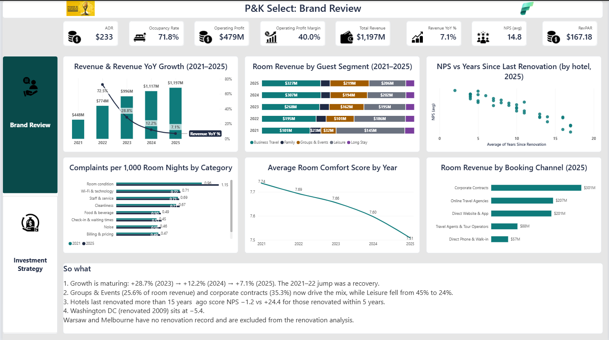
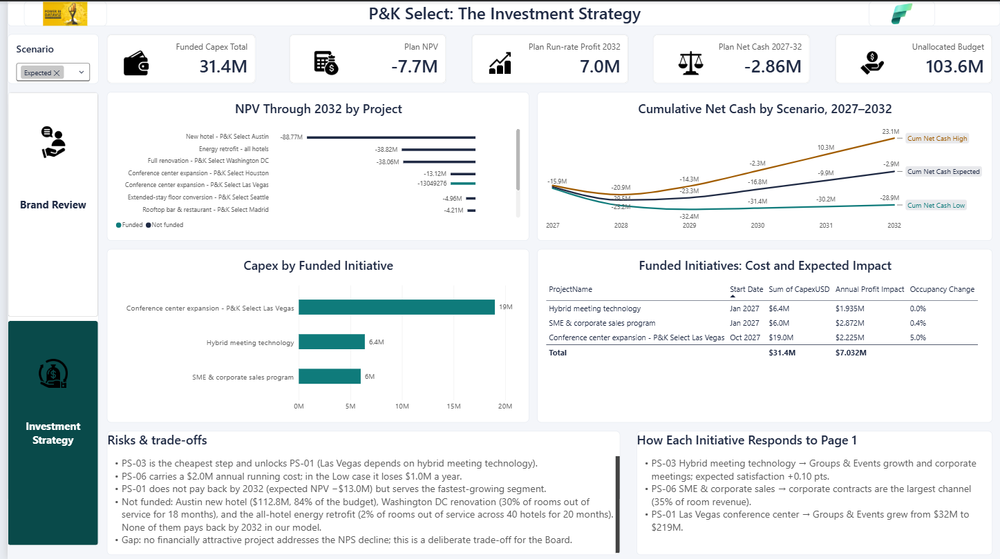

<div align="center">


# ✦ P&K Select: Brand Review & Investment Strategy ✦

**Power BI dashboard | Dataviz World Champs 2027 · Round 1**

*Growth is slowing and satisfaction is slipping. Where should a limited budget go?*


</div>

* * *

<div align="center">

## ✦ THE CHALLENGE ✦

</div>

This is my entry for **Round 1 of the Power BI Dataviz World Champs 2027** (Microsoft Fabric Community).
I chose the **P&K Select** brand of the fictional **Pillow & Key Group** and built a two-page report:

1. **Brand Review:** what is happening to the brand?
2. **Investment Strategy:** which projects should the Board fund within the budget?

> The dataset is the fictional contest dataset provided by the organisers. It does not describe a real company.

* * *

<div align="center">

## ✦ DASHBOARD ✦

</div>

**Page 1 · Brand Review**



**Page 2 · Investment Strategy**



* * *

<div align="center">

## ✦ KEY FINDINGS ✦

</div>

### Page 1: Growth is slowing; satisfaction is slipping

- **Growth is maturing:** revenue growth went +28.7% (2023) → +12.2% (2024) → +7.1% (2025). The 2021–22 jump was a recovery.
- **The mix has shifted:** Groups & Events (25.6% of room revenue) and corporate contracts (35.3%) now drive the business, while Leisure fell from 45% to 24%.
- **Renovation matters:** hotels last renovated more than 15 years ago score an NPS of −1.2, against +24.4 for hotels renovated within 5 years. Washington DC (renovated 2009) sits at −5.4.
- Warsaw and Melbourne have no renovation record and are excluded from the renovation analysis.

### Page 2: Investment strategy

**Funded**

| Project | Why |
|:---|:---|
| **PS-03** Hybrid meeting technology | Cheapest step; unlocks PS-01; supports Groups & Events and corporate meetings (expected satisfaction +0.10 pts) |
| **PS-06** SME & corporate sales | Corporate contracts are the largest channel (35% of room revenue); carries a $2.0M annual running cost and loses $1.0M a year in the Low case |
| **PS-01** Las Vegas conference center | Serves the fastest-growing segment (Groups & Events grew from $32M to $219M), but does not pay back by 2032 (expected NPV −$13.0M) |

**Not funded:** Austin new hotel ($112.8M, 84% of the budget), Washington DC renovation (30% of rooms out of service for 18 months), and the all-hotel energy retrofit (2% of rooms out of service across 40 hotels for 20 months). None of them pays back by 2032 in the model.

**Gap:** no financially attractive project addresses the NPS decline. This is a deliberate trade-off left for the Board.

* * *

<div align="center">

## ✦ PROJECT UNIVERSE ✦

</div>

```
pk-select-investment-strategy/
├── powerbi/
│   └── PK_Select_Investment_Strategy.pbix   # the full report
├── docs/
│   └── dax-measures.md                      # all 34 DAX measures, explained
└── images/                                  # dashboard screenshots
```

Open the report with [Power BI Desktop](https://powerbi.microsoft.com/desktop/).

* * *

<div align="center">

## ✦ HOW IT WAS BUILT ✦

</div>

| Step | What happened |
|:---|:---|
| ✦ **Understand** | Read the brand brief and the contest rules; picked one brand and two pages |
| ✦ **Model** | Built the data model from the provided tables and wrote 34 DAX measures (see [`docs/dax-measures.md`](docs/dax-measures.md)) |
| ✦ **Analyse** | Revenue and growth, guest segments and channels, NPS vs. renovation age, complaints and comfort scores |
| ✦ **Decide** | Compared investment projects by NPV, net cash (Low / Expected / High scenarios) and budget |
| ✦ **Tell the story** | Two pages: *what is happening* and *what to do about it* |

* * *

<div align="center">

## ✦ A LITTLE CURIOSITY GOES A LONG WAY ✦

**One insight at a time.**

[](https://www.linkedin.com/in/hager-naser/)

*Back to my [little universe](https://github.com/hagernaser622) 🪐*

</div>
